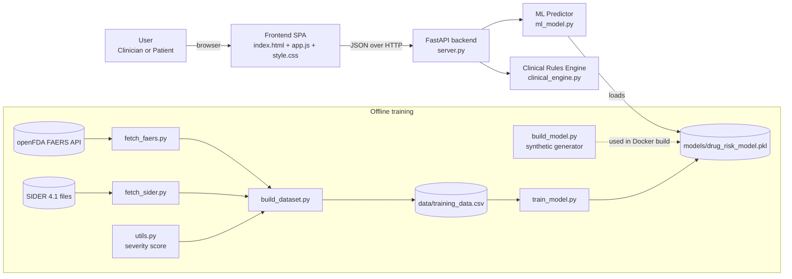
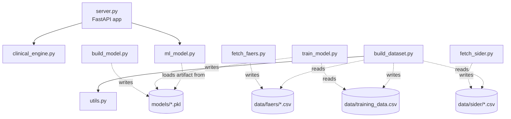
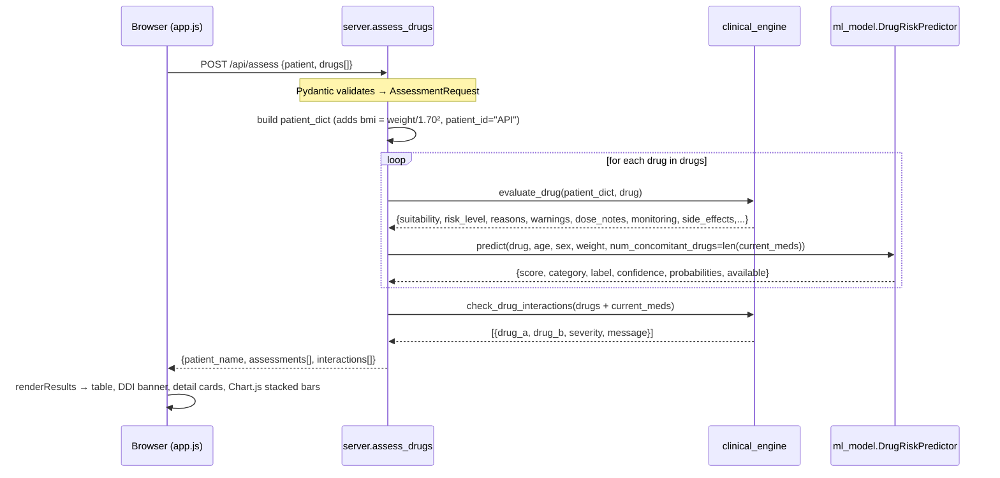
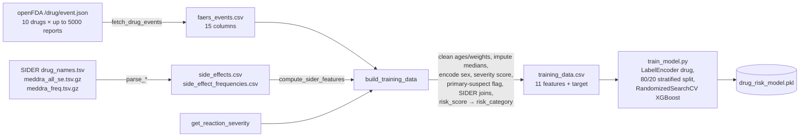
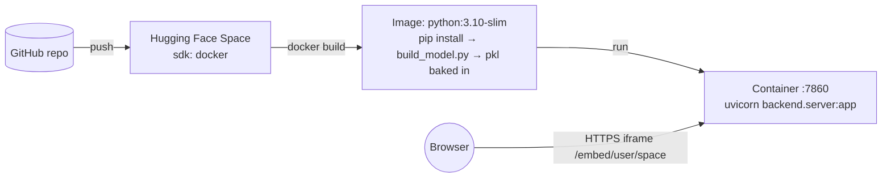

# 03 — Architecture

(Mermaid diagrams render on GitHub / most Markdown viewers. ASCII versions are included so you can
redraw them on a whiteboard.)

## 1. System context — the 30,000-ft view



```
                         ┌──────────────────────────── ONLINE (runtime) ────────────────────────────┐
  Browser  ──HTTP/JSON──►│ FastAPI (server.py)                                                      │
 (index.html,            │   ├─ /api/health  /api/drugs  /api/assess  /api/interactions             │
  app.js, style.css)     │   ├─ clinical_engine.py  → verdict, reasons, dose notes, DDI  (RULES)   │
                         │   └─ ml_model.py         → risk class + probabilities          (XGBoost) │
                         │         └─ loads models/drug_risk_model.pkl at first request             │
                         └──────────────────────────────────────────────────────────────────────────┘

                         ┌──────────────────────────── OFFLINE (training) ──────────────────────────┐
  openFDA ─► fetch_faers ─┐                                                                         │
                          ├─► build_dataset (+utils.get_reaction_severity) ─► training_data.csv      │
  SIDER ──► fetch_sider ──┘                                       └──► train_model ─► drug_risk_model.pkl
  (Docker/HF path:  build_model.py ── synthetic data ──────────────────────────────► drug_risk_model.pkl)
                         └──────────────────────────────────────────────────────────────────────────┘
```

**Key architectural properties**
* **Stateless API** — nothing is stored; every `/api/assess` request carries the whole patient profile. No DB, no auth, no PHI persisted (good for privacy; also why it's a demo).
* **Single deployable** — FastAPI also serves the static frontend, so one container/one port.
* **Decoupled training** — the web app never trains; it only loads a pickled artifact → fast start, simple.
* **Two interchangeable training paths** that emit the *same artifact schema* (`model, label_encoder, feature_cols, risk_labels, accuracy`).
* **Fail-soft ML** — no model / unknown drug / prediction error ⇒ `{"available": false, ...}`; the rules result is still returned.

## 2. Backend components (module dependency graph)



Only **two** module-to-module imports exist at runtime: `server → clinical_engine`, `server → ml_model`.
`build_dataset → utils` is the only import in the pipeline (done with a `try/except ImportError` so it works as
`python -m backend.build_dataset` *and* `python backend/build_dataset.py`).

## 3. Request sequence — `POST /api/assess` (the core flow)



ASCII call tree for the same request:

```
POST /api/assess
└─ server.assess_drugs(request)
   ├─ get_predictor()                         → singleton DrugRiskPredictor (loads pickle once)
   ├─ for each drug:
   │   ├─ clinical_engine.evaluate_drug()
   │   │    └─ compute_risk_level()
   │   └─ DrugRiskPredictor.predict()
   │        ├─ label_encoder.transform([drug])
   │        ├─ model.predict(features)
   │        └─ model.predict_proba(features)
   └─ clinical_engine.check_drug_interactions()
```

## 4. Training / data pipeline



## 5. ML inference path (what happens inside `predict`)

```
drug_name "Paracetamol" ──lowercase/strip──► "paracetamol" ──alias──► "acetaminophen"
   └─ label_encoder.transform → integer id (unknown → return available:false)
patient_sex "F"/"FEMALE" → 1 else 0
features = [drug_id, age, sex, weight, reaction_count=0, weighted_reaction_score=1.0,
            is_primary_suspect=1, num_concomitant_drugs, known_se=0, mean_se_freq=0, max_se_freq=0]
XGBoost.predict → class 0..3        XGBoost.predict_proba → 4 probabilities
return {score=class/3, category, label, confidence=max(prob)*100, probabilities{label:%}, available:true}
```
The 6 hard-coded values are the train/serve-skew issue (see [10](10-known-issues-and-defence.md)).

## 6. Frontend architecture

```
index.html  (structure: topbar, sidebar form, content cards, wizard container)
   ├─ style.css   (dark glassmorphism theme, CSS variables, responsive rules)
   └─ app.js      (state + rendering; no framework)
        state:   selectedDrugs:Set, drugCatalog:[], patientWizardStep:int, patientData:{}
        flow:    DOMContentLoaded → checkApiStatus + loadDrugCatalog + setupEventListeners
        doctor:  collectPatientProfile → runAssessment → renderResults →
                   renderSummaryTable / renderInteractions / renderDetailCards / renderMLChart
        patient: renderPatientWizard (6 steps) → wizardNext/Back/SaveStep →
                   runPatientAssessment → renderPatientResults
```
Rendering approach: build HTML strings with template literals and assign to `innerHTML`
(simple; no virtual DOM). Trade-off: no automatic escaping — safe here because all strings come from our own
backend, but worth mentioning (XSS awareness) if drug names ever became user-supplied.

## 7. Deployment architecture



* Model baked **into the image** → no runtime downloads, cold start is fast, reproducible (`random_state=42`).
* One process serves `/` (index.html), `/{file}` (css/js), `/static/*`, and `/api/*`.
* Catch-all `GET /{file_name}`: returns the file if it exists in `frontend/`, otherwise falls back to `index.html` (SPA-style fallback).

## 8. Design decisions worth quoting

| Decision | Alternative | Why this one |
|----------|-------------|--------------|
| Hybrid rules + ML | pure ML / pure rules | explainability + safety + data-driven signal |
| Stateless REST | sessions / DB | no PHI stored, trivial to scale/deploy |
| Pickled artifact dict | MLflow / ONNX | simplest thing that works for one model; carries encoder + feature list + labels together |
| Synthetic-data trainer for deploy | commit pkl / LFS / download at runtime | HF rejected binaries; no network needed at build; deterministic |
| Vanilla JS | React/Vue | no build step; small app; one-container deploy |
| CORS `*` | restricted origins | dev convenience (two ports); acceptable for a public demo with no credentials — tighten for production |
